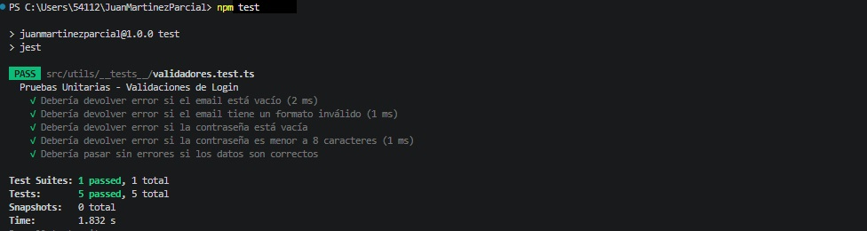

# 📱 Parcia2 - Lista de compras inteligente

**Alumno:** Juan Ignacio Martinez (ISTEA)

### 📌 Opción elegida

---

## 📂 Estructura del Proyecto

```text
├── src/
│   ├── components/
│   │   └── ModalAgregar.tsx
│   ├── context/
│   │   └── ContextoAutenticacion.tsx
│   ├── redux/
│   │   ├── slices/
│   │   │   └── comprasSlice.ts
│   │   └── store.ts
│   ├── screens/
│   │   ├── PantallaLogin.tsx
│   │   └── PantallaPrincipal.tsx
│   └── utils/
│       ├── __tests__/
│       │   └── validadores.test.ts
│       └── validadores.ts
├── App.tsx
```

## 🖼️ Vista Previa del test



## 🚀 Funcionalidades implementadas

- **Login y Registro:** Validé el formato del correo y que la clave tenga al menos 8 caracteres. Sin cuenta no se puede entrar.
- **Estado Global (Redux Toolkit):** Centralización del estado con un `store` global y un `comprasSlice` para agregar, eliminar y actualizar productos.
- **Cámara y Galería:** Uso de `expo-image-picker` para sacar fotos en vivo o elegir de la galería y adjuntarlas a la compra.
- **Geolocalización:** Uso de `expo-location` para capturar la ubicación de forma obligatoria al guardar un nuevo producto.
- **Calendario Nativo:** Uso de `expo-calendar` para crear un evento automático en el celular como recordatorio de la compra.
- **Agenda de Contactos:** Uso de `expo-contacts` para abrir la agenda del celular y asignarle un proveedor a cada producto.

## 🎥 Video DEMO

[Enlace Video DEMO de la app en YouTube](https://www.youtube.com/watch?v=hjuQ7bGYUc4)
